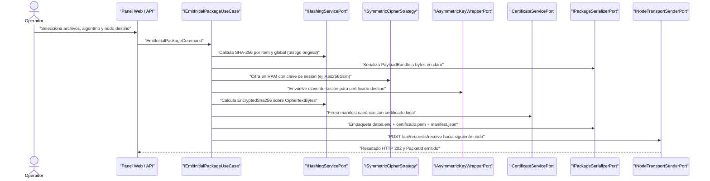
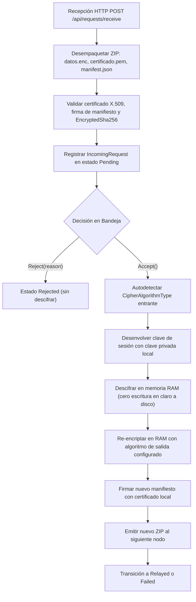
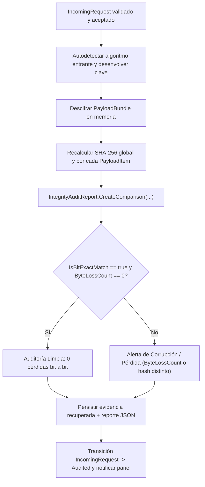
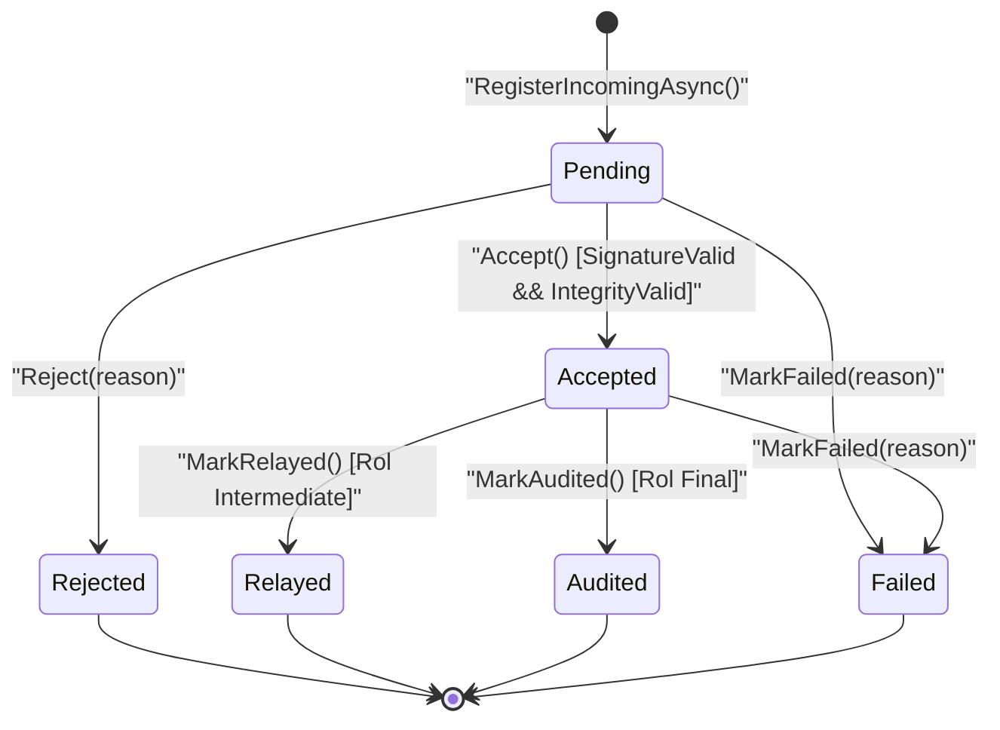

# Diagramas de Flujo por Rol Operativo

Este documento describe los flujos principales de los tres roles intercambiables de `RelayCryptoNode` (`Initial`, `Intermediate`, `Final`) y la máquina de estados de `IncomingRequest`.

---

## 1. Rol `Initial` (Emisor Inicial)

---

## 2. Rol `Intermediate` (Relevo Polimórfico en RAM)

---

## 3. Rol `Final` (Receptor y Auditor Bit a Bit)

---

## 4. Máquina de Estados de `IncomingRequest`

